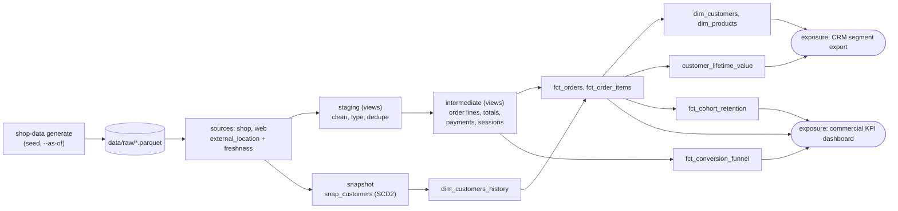

# dbt-duckdb-ecommerce

[](https://github.com/rahulkumar96t/dbt-duckdb-ecommerce/actions/workflows/ci.yml)

An analytics-engineering reference project: a seeded Python generator writes raw e-commerce
extracts (customers, products, orders, order lines, payments, web events) as parquet, and a
dbt-core project on DuckDB turns them into tested, documented marts: order and order-line facts,
customer and product dimensions, a type-2 customer history from a dbt snapshot, customer lifetime
value with RFM segments, a session conversion funnel and monthly cohort retention. Everything
runs locally in seconds, with no warehouse, server or credentials.

## Features

- **Seeded raw data with history**: the generator simulates 18 months once and can extract the
  state *as of* any date, so two loads a month apart describe the same shop at two points in time.
  Loyalty tiers move up with spend, some customers change e-mail or country, orders progress
  through placed / shipped / delivered / cancelled / returned.
- **Realistically messy sources**: mixed-case statuses, untrimmed e-mails, lower-case country
  codes, payments in integer cents, at-least-once web events (duplicates), split gift-card
  payments, declined attempts with retries, refunds.
- **Layered dbt project**: sources (with freshness) -> staging views -> intermediate views ->
  mart tables, custom schema names, shared cleaning macros.
- **Marts**: `fct_orders`, `fct_order_items`, `dim_customers`, `dim_products`,
  `dim_customers_history` (SCD2), `customer_lifetime_value`, `fct_conversion_funnel`,
  `fct_cohort_retention`.
- **Snapshot**: `snap_customers` (timestamp strategy), used for a point-in-time join that gives
  every order the loyalty tier and country the customer had when ordering.
- **Tests**: 114 data tests (generic, four custom generic tests, nine singular business-rule
  tests such as "payments reconcile to order totals"), 3 dbt unit tests, plus 14 pytest tests
  for the generator and an end-to-end two-load dbt run.
- **Docs**: descriptions on every source, model, snapshot and model column (checked against the
  generated catalog), a project overview page and two exposures (a dashboard and a CRM export).

## Architecture



DuckDB reads the parquet files in place through dbt-duckdb's `external_location`, so there is
no load step. The warehouse is a single file, `warehouse/shop.duckdb`.

## Quickstart

Requires [uv](https://docs.astral.sh/uv/) and `make`. Python 3.12 is pinned in
`.python-version`; dbt-core 1.12 and dbt-duckdb 1.11 are locked in `uv.lock`.

```bash
make install            # uv sync --locked
make data build docs    # generate raw data, freshness + dbt build, docs catalog
make docs-serve         # browse the docs and lineage graph on http://localhost:8080
```

To see the snapshot record real changes, run two loads a month apart:

```bash
make history            # load as of 2026-05-31, build, load as of 2026-06-30, build
```

## Usage

```bash
uv run shop-data generate --out data/raw --as-of 2026-05-31   # --seed, --customers, --products
uv run dbt build --profiles-dir . --select +fct_orders          # one mart and its upstream
uv run dbt test  --profiles-dir . --select test_type:unit       # only the unit tests
uv run dbt show  --profiles-dir . --limit 5 \
    --inline "select * from {{ ref('fct_cohort_retention') }} where month_number = 1"
uv run dbt compile --profiles-dir . --select revenue_by_tier_at_order   # analyses/
```

The profile lives in the repository (`profiles.yml`), so nothing is written to `~/.dbt`.
`SHOP_RAW_DIR` and `SHOP_DUCKDB_PATH` override where raw files and the database live.

## Results of a local run

Measured on an Apple M4 Pro (12 cores, 24 GB) with Python 3.12.11, dbt-core 1.12.6,
dbt-duckdb 1.11.1, DuckDB 2.0.0:

- `make history` (two generator runs, freshness, two full `dbt build`s): about 17 s wall time;
  each `dbt build` reports PASS=136, WARN=0, ERROR=0 (138 nodes including 2 exposures).
- Second load (as of 2026-06-30): 4,000 customers, 150 products, 10,733 orders, 19,203 order
  lines, 12,918 payment rows, 156,064 raw events (before de-duplication).
- The snapshot closed 205 customer versions between the two loads (tier upgrades and the rarer
  e-mail / country changes), which `fct_orders.loyalty_tier_at_order` picks up.

These are properties of synthetic data, shown to make the run reproducible, not business
findings.

## Design decisions and trade-offs

- **Simulate once, extract as of a date.** All randomness is drawn for the full period before
  anything is filtered, so `--as-of` never changes what happens, only what is visible yet. This
  is what makes a realistic multi-load SCD2 demo possible from a generator.
- **Snapshot the raw source, clean downstream.** Snapshots should capture what the source said;
  `dim_customers_history` applies the same cleaning macros as staging. Cleaning before the
  snapshot would bake today's rules into history.
- **First observed version stretched back.** History starts at the first snapshot run. The
  oldest version of each customer is given `valid_from = 1900-01-01` so older orders still join;
  this is a documented approximation (a customer upgraded before the first load shows the
  upgraded tier on early orders) and `recorded_from` keeps the real observation time.
- **Money as decimals, payments in cents.** Amounts are cast to `decimal(12, 2)` in staging and
  payments are converted from integer cents, so reconciliation compares exact values.
- **Reconciliation as a test, not a dashboard.** `assert_payments_reconcile_to_order_totals`
  fails the build if succeeded charges minus refunds differ from what each order owes (zero after
  cancellation or return). Other singular tests check order lines vs. order totals, funnel
  monotonicity, cohort month 0 = 100 %, contiguous SCD2 windows, one purchase session per order
  and CLV vs. order revenue.
- **Funnel flags from real events.** Session step flags are not implied ("purchase means it also
  checked out"); the monotonicity test then catches tracking gaps instead of hiding them.
- **Reproducible recency.** Lifecycle status and RFM recency are measured against the newest order
  in the data, not the wall clock, so the same load always gives the same marts.
- **CLV kept honest.** `customer_lifetime_value` reports historical value and RFM scores; its
  `expected_12m_margin` is an openly naive run-rate projection, labelled as such, rather than an
  unvalidated probabilistic model.
- **No packages.** The custom generic tests (`non_negative`, `accepted_range`,
  `is_normalised_text`, `equal_row_count`) replace dbt_utils so `dbt deps` (network) is never
  needed. Telemetry and the version check are disabled in `dbt_project.yml`.
- **Views for staging and intermediate, tables for marts.** Cheap to rebuild on DuckDB;
  incremental models would be the next step at real volumes.

## Testing

```bash
uv run ruff check . && uv run pytest -q     # 14 tests, about 11 s
make history                                  # dbt build twice: 136 passing nodes per build
```

- **Generator** (pytest): same seed gives identical data, a different seed differs, the load
  time only changes `_loaded_at`, nothing after `as_of` leaks, the early load is a consistent
  prefix of the later one, customer changes move `updated_at`, referential integrity, payments
  reconcile in the raw data, the intended messiness is present, tiers only go up.
- **Parquet writer**: schemas round-trip through DuckDB.
- **dbt end to end** (pytest, `-m dbt`): two loads into a temporary DuckDB file through
  `dbtRunner`, then assertions on the marts (row counts, closed snapshot versions, point-in-time
  tiers, month-0 retention, de-duplicated events).
- **dbt unit tests**: payment summary (declined retry, split gift-card payment fully refunded),
  sessionisation (first-event attribution), cohort spine (empty months, cancelled orders).
- **dbt data tests**: keys, relationships, accepted values / ranges, plus the singular tests.

## Limitations and roadmap

- Single currency, no taxes, no partial returns, product costs do not change over time.
- Customers are the only snapshotted entity; products could get the same treatment.
- Marts are full rebuilds. At production volume, `fct_orders` and the event models would be
  incremental (merge on `updated_at` with a lookback window for late-arriving status changes).
- No semantic layer / metrics definitions yet; the exposure is descriptive only.
- The CLV projection is a placeholder for BG/NBD + Gamma-Gamma.
- SQL style is consistent by convention; a SQLFluff configuration would enforce it in CI.

## Project layout

```
src/shop_data/        generator, parquet writer, CLI (shop-data)
models/staging/       sources (+ freshness) and staging models
models/intermediate/  reusable building blocks (+ unit tests)
models/marts/         facts, dimensions, CLV, funnel, cohorts, exposures (+ unit test)
snapshots/            snap_customers (SCD2, YAML-defined)
data_tests/           singular tests and data_tests/generic/ custom generic tests
macros/               cleaning helpers, safe_divide, schema naming
analyses/             example point-in-time analysis
tests/                pytest: generator, writer, end-to-end dbt run
```

## License

MIT, see [LICENSE](LICENSE).
